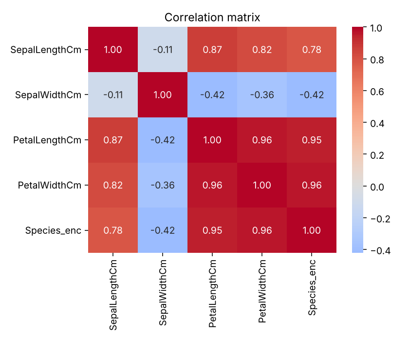
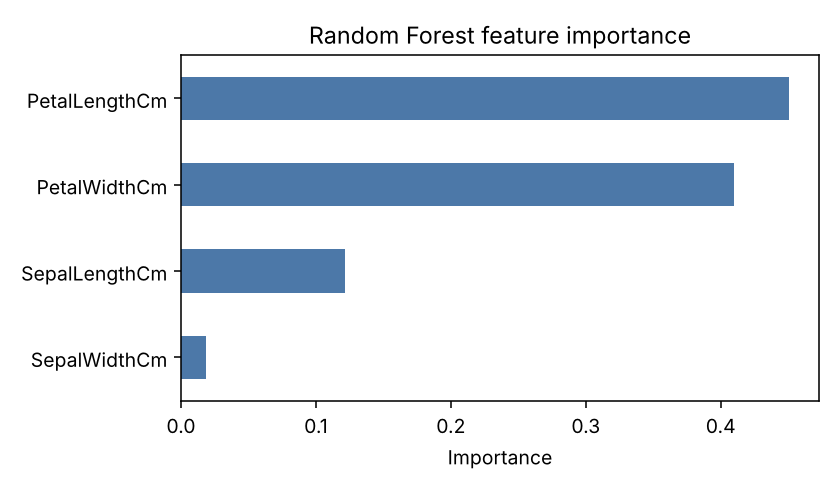
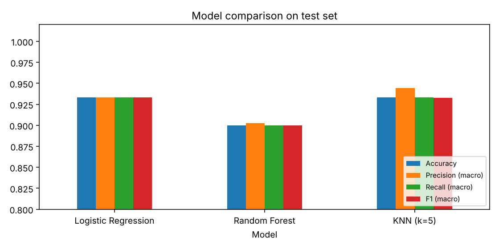
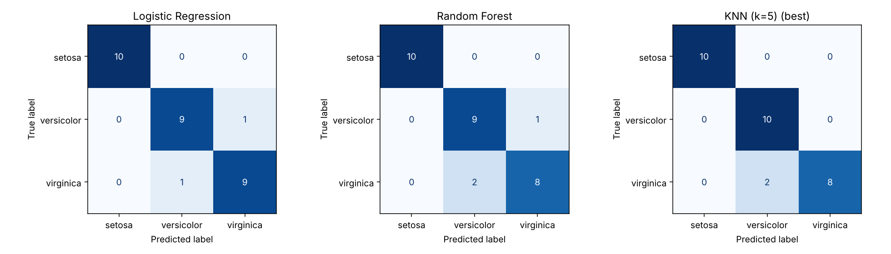

# 🌸 Iris Flower Species Classification using Machine Learning

A machine learning project that classifies Iris flowers into three different species using Logistic Regression, Random Forest, and K-Nearest Neighbors (KNN).

The project focuses on data preprocessing, feature analysis, model training, performance evaluation, and comparison of multiple classification algorithms.

## 📌 Project Overview

The Iris dataset contains measurements of flower features that can be used to identify different Iris species.

This project builds and evaluates three machine learning classification models to determine which algorithm performs best on the dataset.

**Target Classes:**
- Iris-setosa
- Iris-versicolor
- Iris-virginica

## 🎯 Objectives

- Explore and understand the Iris dataset.
- Perform data preprocessing and feature analysis.
- Understand relationships between different features.
- Train multiple machine learning classification models.
- Evaluate model performance using different metrics.
- Compare models and identify the best-performing algorithm.

## 🛠️ Technologies Used

- **Python** – Programming language
- **Pandas** – Data manipulation and preprocessing
- **NumPy** – Numerical computations
- **Matplotlib** – Data visualization
- **Seaborn** – Statistical data visualization
- **Scikit-learn** – Machine learning algorithms and evaluation

## 🤖 Machine Learning Algorithms

This project implements three classification algorithms:

### 1. Logistic Regression
A supervised machine learning algorithm used for classification by estimating the probability of different classes.

### 2. Random Forest
An ensemble learning algorithm that combines multiple decision trees to improve classification performance.

### 3. K-Nearest Neighbors (KNN)
A distance-based algorithm that classifies a data point based on the majority class of its nearest neighbors.

## 🔍 Project Workflow

### 1. Data Loading and Preprocessing
- Load the Iris dataset using Pandas.
- Check dataset shape and missing values.
- Identify duplicate records.
- Remove unnecessary columns.
- Encode target labels into numerical values.
- Split data into training and testing sets (80:20).

### 2. Exploratory Data Analysis
- Analyze relationships between flower features.
- Generate a correlation matrix.
- Identify important features using Random Forest.
- Visualize feature distributions and relationships.

### 3. Model Training
Train the following models:
- Logistic Regression
- Random Forest
- KNN (k=5)

StandardScaler is applied to Logistic Regression and KNN through pipelines.

### 4. Model Evaluation

Evaluate model performance using:

- Accuracy
- Precision
- Recall
- F1-Score
- 5-Fold Cross-Validation

### 5. Model Comparison

Compare all three algorithms using their evaluation metrics and select the best-performing model based on cross-validation accuracy.

## 📊 Visualizations

### 1. Feature Correlation Matrix

Displays the correlation between different flower measurements and the target species.



### 2. Feature Importance

Shows the relative importance of different features in the Random Forest model.



### 3. Model Performance Comparison

Compares the performance of Logistic Regression, Random Forest, and KNN.



### 4. Confusion Matrices

Visualizes correct and incorrect predictions made by each classification model.



## 📁 Project Structure

```text
MachineLearning/
│
├── iris_pipeline.py
├── model_comparison.csv
│
├── 01_correlation.png
├── 02_feature_importance.png
├── 04_model_comparison.png
├── 05_confusion_matrices.png
│
├── LICENSE
└── README.md
```

## 🚀 How to Run the Project

### 1. Clone the repository

```bash
git clone https://github.com/shreyashiijain/MachineLearning.git
```

### 2. Navigate to the project directory

```bash
cd MachineLearning
```

### 3. Install the required libraries

```bash
pip install numpy pandas matplotlib seaborn scikit-learn
```

### 4. Add the Iris dataset

Place the `Iris.csv` dataset in the project directory.

### 5. Update file paths

In `iris_pipeline.py`, update the dataset and output paths to your local directory:

```python
df = pd.read_csv("Iris.csv")
OUT = "./"
```

### 6. Run the Python script

```bash
python iris_pipeline.py
```

The script will train the models, evaluate their performance, and generate comparison results and visualizations.

## 📚 Key Learnings

- Understanding supervised machine learning.
- Working with classification algorithms.
- Data preprocessing and label encoding.
- Feature correlation and feature importance.
- Training and testing machine learning models.
- Model evaluation using classification metrics.
- Understanding cross-validation and confusion matrices.

## 👩‍💻 Author

**Shreyashi Jain**

- GitHub: [@shreyashiijain](https://github.com/shreyashiijain)
- LinkedIn: [Connect with me](https://www.linkedin.com/in/shreyashi-jain-9a81a4333/)

---

⭐ If you find this project interesting, consider giving the repository a star!

